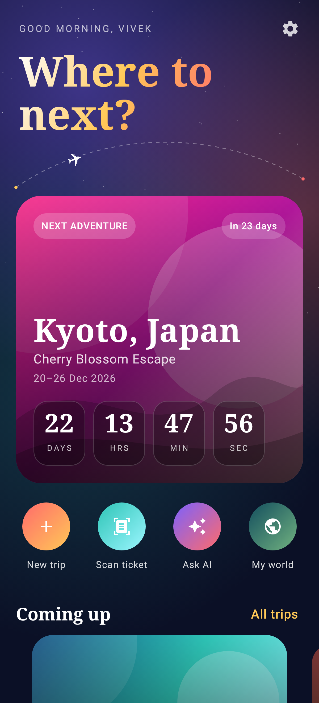
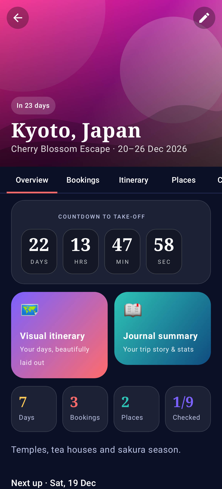
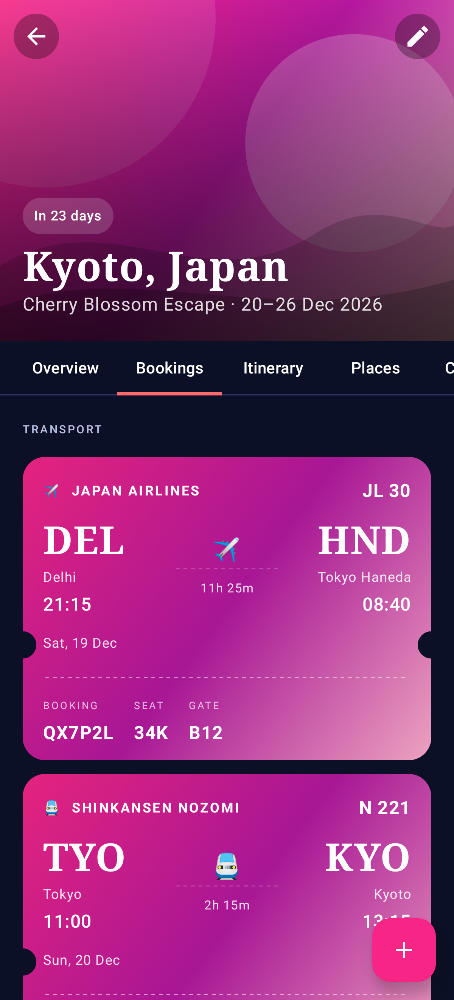
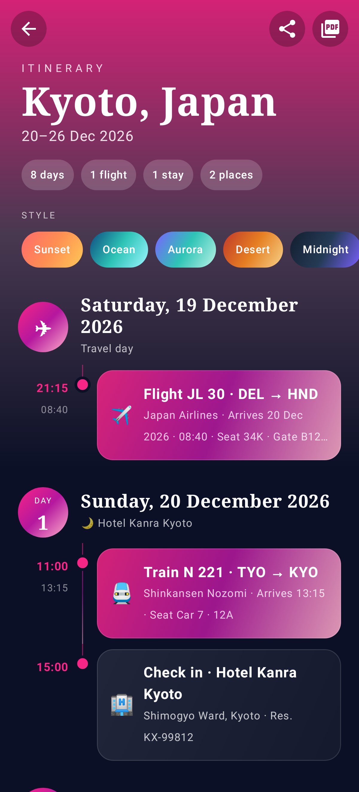
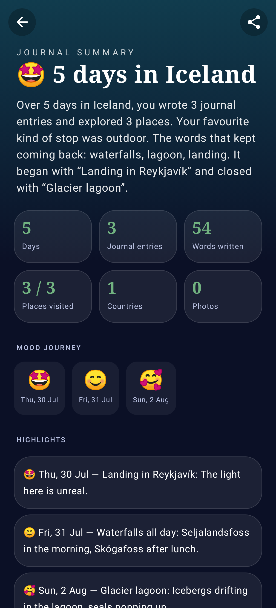

# Wanderlust

This app keeps all your travel history, flight and hotel tickets, and memories in one place.

Wanderlust is a native **Android app written in Kotlin with Jetpack Compose**. It keeps track of everything for a trip: flights and other transport, hotels, places, itinerary, checklists, journal and photos. From those it builds an illustrated day-by-day itinerary and counts down to take-off. An AI travel agent built on Claude answers your travel questions.

The data model and feature set follow the open-source [AdventureLog](https://github.com/seanmorley15/AdventureLog) project, rebuilt as an offline-first mobile app. No AdventureLog code is copied; it is a Django/SvelteKit web app under GPL-3.0.

## Screenshots

| Home | Trip | Bookings | Visual itinerary | Journal summary |
|---|---|---|---|---|
|  |  |  |  |  |

*(Rendered with Robolectric from the real screens, using sample data.)*

## Features

| Feature | Details |
|---|---|
| **Striking home screen** | Animated aurora background with twinkling stars, a plane flying along a dashed route, a hero card for your next trip with a **live countdown (days · hrs · min · sec)**, a carousel of upcoming trips, quick actions, travel stats, a polaroid-style memories strip and "Relive" for past trips. |
| **Trips** (AdventureLog *Collections*) | Name, destination, dates, description, cover photo or a generated gradient "postcard" in 7 colour themes. Filters: upcoming, planning, past, archived. |
| **Flight & transport tickets** (AdventureLog *Transportation*) | Plane, train, bus, car, ferry and more. Fields: flight number, from/to with airport codes, departure/arrival, booking ref (PNR), seat, gate. Shown as **boarding-pass cards**. |
| **Hotel tickets** (AdventureLog *Lodging*) | Hotel, hostel, Airbnb-style stays and more. Fields: check-in/out, reservation number, rating. Shown as key-card style cards with a night count. |
| **Upload tickets** | Attach PDFs or images to any booking. They are copied into private app storage and open with one tap. You can also share a ticket PDF into the app from Gmail or an airline app. |
| **AI import (tickets, hotels, itineraries)** | Upload **several images and/or PDFs at once**. Claude splits them into individual flights and stays, each with its own original file attached. An **itinerary** (travel-agent PDF, screenshots, photos of a printed plan) also fills in the places to visit and each day's activities. You tick what to keep in a preview before saving. Also available inside the flight/hotel editors (*Auto-fill with AI*): extra bookings found in the files are offered as separate bookings. Files with no booking (for example the itinerary itself) are kept as **trip documents**. |
| **Visual itinerary** | Builds a timeline from your flights, check-ins and check-outs, places and activities. Each day gets a header and shows where you sleep that night. There are 7 switchable styles. **Export as a designed multi-page PDF**, or share as text. |
| **Places** (AdventureLog *Locations/Visits*) | 15 categories, rating, visited flag, visit time. **Search on OpenStreetMap (Nominatim)**, the same geocoder AdventureLog uses, to get coordinates, city and country. |
| **Maps** | Interactive OpenStreetMap on each trip and on "Your world", with a **search bar on the map**: search any place, preview it, and add it to a trip with a category in one tap. Pins are coloured by visited or planned. The trip map opens centred on its destination. |
| **World stats** (AdventureLog *World travel*) | Countries with flags, places visited, travel days, flights, other rides, hotel nights, favourite kinds of places. |
| **Itinerary activities** (AdventureLog *Itinerary items*) | Custom activities per day with start/end time, emoji and an "optional" flag. |
| **Checklists** | A packing list is created automatically for each new trip. You can add more lists (To-do…) and track progress. |
| **Travel journal** (AdventureLog *Notes*) | Daily entries with mood, text and a photo. |
| **Journal summary** | Works offline: headline, stats, mood timeline, snapshots, highlights, category breakdown and "words of the trip". **AI story**: Claude turns your entries into a short written recap with highlights and day by day. |
| **AI travel agent** | A chat that **streams answers as they are written**, keeps your conversation between sessions, sees your trips and can **act on them**. It can add itinerary items, checklist items and places, and it uses **web search** for visas, opening hours, weather and events. |
| **Backup & restore** | *Settings → Backup & restore* exports everything into one `.zip`: trips, bookings, tickets, journals, expenses and photos (never the API key). Save it to Google Drive or anywhere you like, and restore it on the same phone or a new one (file paths are remapped). Optional **automatic daily or weekly backup** to a file you pick. Android's Google backup also covers the database and tickets. |
| **Reminders** | Notifications 7, 3 and 1 days before a trip; **flight check-in 24 h** and **leave for the airport 3 h** before departure; train/bus 1 h before; hotel check-in and check-out days. Rescheduled automatically when trips change and after a reboot. Tapping one opens the trip. |
| **Countdown widget** | Home-screen widget with days to your next trip, or "Day X of Y" while you travel. |
| **Expenses** | Per-trip expense tracker in any currency, converted to your home currency (rates from open.er-api.com, cached for offline use). Budget bar, per-day average, breakdown by category. **Scan a receipt** and AI fills in merchant, total, currency, date and category. |
| **Weather** | Open-Meteo forecast for trip days within the next 16 days, and "typical" weather (same dates last year) for later trips. Shown on the overview, the itinerary tab and the visual itinerary. |
| **Add to calendar** | Writes the trip, flights, hotel stays, timed activities and place visits into a calendar on your phone (for example Google Calendar). Running it again replaces the earlier events, and you can remove them. You can also share a standard `.ics` file. |
| **App lock** | Optional fingerprint, face or screen-PIN lock, re-locking after a minute in the background. The Anthropic API key is encrypted with an Android Keystore key. |
| **In-app updates** | Settings → *App updates* (plus a banner on Home). Sideloaded installs check this repo's latest **GitHub Release**, download the APK, verify it is the same app, signed with the same key and newer, then open Android's installer. Installs from Google Play use **Google Play In-App Updates**. Automatic check at most every 12 h (can be turned off). |
| **Memories / Google Photos** | Add photos with the Android photo picker. On devices where Google Photos is the cloud media app, your Google Photos library shows up in the picker. You can also **share photos from Google Photos straight into a trip** with Share → Wanderlust. |

### About Google Photos

Since March 2025 the Google Photos Library API no longer lets third-party apps read a user's whole library. The only official option left is the Photos *Picker* API, which needs your own Google Cloud OAuth client. Wanderlust uses two routes that need no setup instead:
1. The Android system photo picker, which includes Google Photos cloud media on supported devices.
2. The share sheet from Google Photos.

The Memories tab also has an "Open Google Photos" button.

## AI setup (Claude)

The AI features use the official **Anthropic Java SDK** (`com.anthropic:anthropic-java`), called from Kotlin.

1. Get an API key at <https://console.anthropic.com/settings/keys>.
2. In the app, go to **Home → ⚙️ Settings**, paste the key and choose a model. The default is Claude Opus 5.5; Sonnet 5.5 and Haiku 5.5 are faster and cheaper.

The key is stored only on the device; app backup is turned off. It is sent only to `api.anthropic.com`. Without a key, every other feature still works.

How the agent works (`app/src/main/java/com/wanderlust/app/ai/`):
- It runs a manual tool-use loop on the Messages API. Client tools (`list_trips`, `get_trip_details`, `add_itinerary_item`, `add_checklist_item`, `add_place`) read and write the on-device Room database. Anthropic's server-side `web_search` tool is enabled.
- The full conversation, including thinking and tool blocks, is passed back unchanged on each turn. `pause_turn` and `refusal` stop reasons are handled. The server-side refusal fallback (beta) is on for Opus 5.5 and Sonnet 5.5.
- Tickets are sent as base64 `document` blocks (PDF) or `image` blocks.

## Building

Requirements: JDK 17+, Android SDK with platform 36. Android Studio Ladybug or newer works.

```bash
./gradlew :app:assembleDebug          # APK at app/build/outputs/apk/debug/app-debug.apk
./gradlew :app:testDebugUnitTest      # logic tests + Robolectric screenshots in app/build/screenshots/
```

minSdk 26 (Android 8.0), targetSdk 36.

## Publishing updates (in-app updater)

Releases are built and published by GitHub Actions (`.github/workflows/release.yml`). The app finds them on its own.

**One-time setup**
1. Create your release signing key and **keep it safe**. Every future update must be signed with this same key.
   ```bash
   keytool -genkeypair -v -keystore wanderlust-release.jks -alias wanderlust \
           -keyalg RSA -keysize 4096 -validity 10000
   ```
2. In GitHub, go to **Settings → Secrets and variables → Actions** and add these secrets:
   - `KEYSTORE_BASE64`: output of `base64 -w0 wanderlust-release.jks` (macOS: `base64 -i wanderlust-release.jks`)
   - `KEYSTORE_PASSWORD`, `KEY_ALIAS` (e.g. `wanderlust`), `KEY_PASSWORD`
3. Publish the first release, then install that APK from the Releases page. If you have an older copy that was signed with a different key (any copy you didn't install from Releases), uninstall it first. Android won't update an app across different signing keys.

**Each update**
```bash
git tag v1.1.0
git push origin v1.1.0
```
The workflow sets `versionName` to 1.1.0 and `versionCode` to 10100, builds a signed APK and attaches it to a new GitHub Release with generated notes. You can edit the notes on GitHub; the app shows them. Installed apps offer the update within 12 hours, or right away with **Settings → Check now**.

To build a signed release locally, create a git-ignored `keystore.properties` in the project root:
```properties
storeFile=wanderlust-release.jks
storePassword=...
keyAlias=wanderlust
keyPassword=...
```
Then run `./gradlew :app:assembleRelease -PversionName=1.1.0 -PversionCode=10100`.

Debug builds install as `com.wanderlust.app.debug`, next to the release app, and don't self-update.

## Architecture

```
app/src/main/java/com/wanderlust/app/
├── data/        Room entities + DAO, repository, file store (attachments/photos), settings, Nominatim geocoder
├── domain/      ItineraryBuilder (day-by-day timeline), countdowns, JournalSummarizer
├── ai/          ClaudeService (chat agent, ticket extraction, journal story), AgentTools
├── backup/      BackupManager (zip export/restore, scheduled backups)
├── expenses/    expense tracker, exchange rates
├── reminders/   notification scheduling
├── widget/      countdown home-screen widget (Glance)
├── weather/     Open-Meteo forecasts
├── calendar/    calendar provider + .ics export
├── update/      AppUpdater (GitHub Releases / Google Play in-app updates) + update UI
└── ui/
    ├── home/        animated landing page
    ├── trips/       trip list, trip detail tabs, boarding-pass / stay cards
    ├── editors/     trip, transport, lodging, place, activity, journal editors
    ├── itinerary/   visual itinerary + PDF exporter
    ├── journal/     journal summary
    ├── assistant/   AI chat
    ├── world/       stats + OpenStreetMap
    ├── importing/   scan ticket, share-to-app import
    └── settings/
```

Libraries: Jetpack Compose (Material 3), Navigation Compose, Room, WorkManager, Glance, AndroidX Biometric, Coil 3, osmdroid, Anthropic Java SDK, Google Play In-App Updates.

Database changes go through Room migrations (`autoMigrations` in `Database.kt`, schemas in `app/schemas/`), and `MigrationTest` upgrades a real v1 database. Never use destructive migrations: updates must keep users' data.

Weather by [Open-Meteo](https://open-meteo.com) · Exchange rates by [ExchangeRate-API](https://www.exchangerate-api.com)

Maps © OpenStreetMap contributors.
